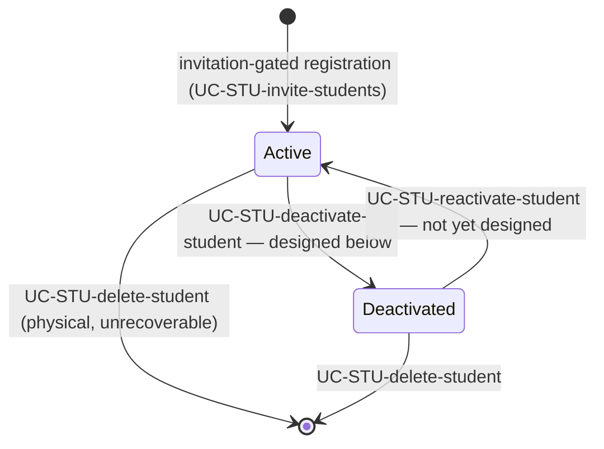
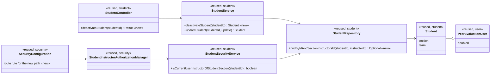

# Student (STU) Design

> Realizes: UC-STU-deactivate-student
> Depends on FRs: FR-SEC-active-account, FR-SEC-authorization, FR-SEC-deny-unauthorized
> Depends on: BR-student-lifecycle, BR-section-scoped-access, BR-role-based-access, BR-submission-owed (downstream consumer)
> See: [use cases](../requirements/use-cases.md#student), [SRS non-use-case FRs](../requirements/software-requirements-specification.md#security-and-authorization-requirements), [architectural-design.md](architectural-design.md#shared-foundation-components) (shared-foundation component view, Authorization)
> Designed against `main` at `59f0267` (2026-10-27).

## Overview

The STU area is the student half of the foundation's `student · instructor` component — the people enrolled in a course section. Its use cases are the account lifecycle around a `Student`: invitation and registration, find and view, team assignment (owned by TEA), deactivation, reactivation, and physical deletion. The area adds no container and no component; it is a vertical slice inside the REST API container drawn in the [shared-foundation component view](architectural-design.md#shared-foundation-components).

This doc currently designs **one** edge of that lifecycle: deactivation. The rest of the area's use cases predate the `/design` workflow and are mapped in [`../traceability.md`](../traceability.md) without a design-of-record; they are not retro-designed here.

**Account state is the `enabled` flag on `PeerEvaluationUser`.** The spec calls the two values *active* and *deactivated* (BR-student-lifecycle, FR-SEC-active-account); the persisted field keeps its older name because renaming a column on the shared user base class is a platform-wide change with no requirement behind it. Prose, UI strings, and new identifiers use the spec's words; only the field and its getter say `enabled`.



Deactivation and deletion are deliberately different exits: deactivation revokes access and keeps the account, its team membership, and its weekly activity reports and peer evaluations; deletion removes all of it.

## Components & classes

Everything below is reused; the four `<<new>>` members are what deactivation adds.



| Layer | File | Role |
|---|---|---|
| Route rule | [`security/SecurityConfiguration.java`](../../backend/src/main/java/team/projectpulse/security/SecurityConfiguration.java) | binds the new path to the guard below |
| Guard | [`StudentInstructorAuthorizationManager`](../../backend/src/main/java/team/projectpulse/security/authorizationmanagers/StudentInstructorAuthorizationManager.java) → [`StudentSecurityService`](../../backend/src/main/java/team/projectpulse/student/StudentSecurityService.java) | reused unchanged; already guards the instructor-only peer-evaluation detail route |
| Backend slice | [`StudentController`](../../backend/src/main/java/team/projectpulse/student/StudentController.java) → [`StudentService`](../../backend/src/main/java/team/projectpulse/student/StudentService.java) → [`StudentRepository`](../../backend/src/main/java/team/projectpulse/student/StudentRepository.java) / [`Student`](../../backend/src/main/java/team/projectpulse/student/Student.java) | one method each; `StudentDto` and its converters unchanged |
| Frontend | [`pages/students/Students.vue`](../../frontend/src/pages/students/Students.vue) → [`apis/student`](../../frontend/src/apis/student/index.ts) | the Deactivate control, its confirmation, and the status column |

## Sequence

### UC-STU-deactivate-student — main success scenario

```mermaid
sequenceDiagram
    actor Actor as course admin / instructor
    participant UI as Students.vue
    participant Api as apis/student
    participant Guard as StudentInstructorAuthorizationManager
    participant Ctl as StudentController
    participant Svc as StudentService
    participant Repo as StudentRepository

    Actor->>UI: opens Student Management, clicks Deactivate on a row (steps 1-3)
    UI-->>Actor: confirmation naming the consequences — access revoked, work kept, reversible (step 4)
    Actor->>UI: confirms (step 5)
    UI->>Api: deactivateStudent(studentId)
    Api->>Guard: PUT /students/{studentId}/deactivation
    Guard->>Guard: isCurrentUserInstructorOfStudentSection(studentId)
    Guard--xApi: 403 — caller is not an instructor of her course section, or no such student (ext. 3a, 6b)
    Guard->>Ctl: authorized
    Ctl->>Svc: deactivateStudent(studentId)
    Svc->>Repo: findByIdAndSectionInstructorsId(studentId, callerId)
    Repo-->>Svc: Student — empty throws ObjectNotFoundException (404)
    Svc->>Svc: set the account deactivated; already deactivated is a no-op (ext. 6a)
    Svc->>Repo: save
    Ctl-->>UI: Result(true, SUCCESS, "Deactivate student successfully", StudentDto)
    UI-->>Actor: success message, list reloaded, the row reads Deactivated (step 6)
```

Steps 4 and 5 are client-only: the warning and the cancel path (ext. 4a) never reach the API, so a cancelled use case issues no request.

## API contract

| Endpoint or job | Caller (who may) | Request | Success | Errors, by extension |
|---|---|---|---|---|
| `PUT /students/{studentId}/deactivation` | an instructor or course admin listed on that student's course section (`StudentInstructorAuthorizationManager`) — never the student herself | no body | `200` `Result(true, SUCCESS, "Deactivate student successfully", StudentDto)`, the DTO reporting the account deactivated | `403` ext. 3a (caller is a student, or an instructor of another course section) and ext. 6b (`studentId` names no row — the guard fails closed before the service runs); `404` if the scoped query finds nothing; ext. 6a (already deactivated) is **not** an error — see Key decisions |

No scheduled job. No existing endpoint changes. The new path does **not** collide with the existing `PUT /students/{studentId}` rule — `{studentId}` matches one path segment, so `/students/4/deactivation` reaches only the new rule — but like every API rule it must sit above the `.denyAll()` catch-all.

## Key decisions

- **Deactivation gets its own route rather than riding the `enabled` field of `PUT /students/{studentId}`.** The generic route is a full-representation update, so a deactivation sent through it also rewrites username, name, and email and can overwrite a concurrent edit; its guard ([`UserOwnershipAuthorizationManager`](../../backend/src/main/java/team/projectpulse/security/authorizationmanagers/UserOwnershipAuthorizationManager.java)) admits the student herself, and the only thing preventing her from activating her own account is a `ROLE_instructor` branch inside `StudentService.updateStudent` — correct, but implicit, and deletable without any route rule noticing. A dedicated route lets the route rule state what BR-student-lifecycle states, and gives the use case a handle that tests and `../traceability.md` can name. *Rejected:* realizing the use case entirely in the SPA over the existing endpoint — the leanest option, and the one the current half-built state already approximates, but it leaves both problems and makes "UC-STU-deactivate-student passes" unassertable.
- **`PUT …/deactivation`, idempotent and bodyless, rather than `PUT …/active` carrying a boolean.** The boolean-state route is the better design for the *pair*, but UC-STU-reactivate-student is not designed yet, and that shape would ship the reactivate direction as an undesigned, untested capability. Reactivation later becomes the complementary verb on this same sub-resource without reshaping this route. *Rejected:* `PATCH` — no foundation route in the codebase uses it.
- **Deactivating an already-deactivated student is a success, not a conflict.** The use case's postcondition is a state, not a transition, and the only way to reach the case is a stale list; the response reports the resulting state, so the SPA can tell the actor she was already deactivated (ext. 6a). *Rejected:* `409 CONFLICT` — invents an error no requirement asks for and makes a retry after a dropped response fail.
- **The service's scope check is `findByIdAndSectionInstructorsId(studentId, callerId)`.** This is the second enforcement point required by [Authorization](architectural-design.md#authorization), and it has to bind the object to the *caller* — her id read from `UserUtils`, never from `SecurityContextHolder` — and not to a course section read from anywhere else: `UserUtils.getUserSectionId()` returns the caller's **default** course section, which is not necessarily this student's, so scoping by it would refuse a student in another course section the same instructor teaches. The derived finder binds both in one query, following the `findByIdAndTeamTeamId` precedent. *Rejected:* an unscoped `findById` followed by a comparison (the shape [`backend/CLAUDE.md`](../../backend/CLAUDE.md) names as the smell to grep for), and trusting the route rule alone.
- **Deactivation writes nothing but the account state.** Team membership and the student's weekly activity reports and peer evaluations are left untouched — that is what separates this use case from UC-STU-delete-student. *Rejected:* also unassigning her from her team, which would strip the team context from her existing weekly-activity-report history and change what instructor reports show for past weeks.
- **The actor set is inherited, not re-derived.** The guard is the same predicate that already governs `GET` and `PUT /students/{studentId}`, so this route admits exactly the actors UC-STU-view-student admits, less the student herself. It rests on a provisioning invariant: **a course admin must be listed among the instructors of the course sections she owns** (as `seed/DataInitializer` seeds her), because the predicate resolves the student's course section and looks for the caller in its instructor list. An admin not so listed is refused — the same class of provisioning invariant the architecture-of-record already records for the `roles` string under [Authorization](architectural-design.md#authorization). *Rejected:* widening the predicate to course ownership, which would add a second notion of who may reach a student and desynchronize this route from the rest of the area.

## Data model

**No delta.** `enabled` already exists on `PeerEvaluationUser`, shared by `Student` and `Instructor`; no new table, column, or Flyway migration. For the entities and associations see the SRS's Business Domain Model and the architecture-of-record's [Domain and aggregate model](architectural-design.md#domain--aggregate-model).

## Reuse & cross-cutting

- **Authorization** — both enforcement points are existing machinery: the route rule in `SecurityConfiguration` plus the reused guard/security-service pair, and a team-or-section-scoped repository query in the service.
- **Authentication (FR-SEC-active-account)** — nothing to build for the login half: `MyUserPrincipal.isEnabled()` feeds Spring Security directly, so a deactivated student's next login is refused with no extra code. See Open questions for the half that *is* missing.
- **BR-submission-owed** — already filters on the account state ([`SubmissionStatusService.findOwedItems`](../../backend/src/main/java/team/projectpulse/notification/SubmissionStatusService.java)), so a deactivated student stops being reminded and stops being a teammate her peers must evaluate. **The NOT area needs no change**, and this design adds no test there; `SubmissionStatusServiceIntegrationTest` already covers a deactivated account.
- **No email.** The use case notifies only the actor, and `CI-email-notifications` lists no account-lifecycle mail, so `EmailService` is not involved.
- **UI** — the confirmation reuses Element Plus's message box; no new component.

## Tests

| Use case, flow | Level | Asserts |
|---|---|---|
| UC-STU-deactivate-student, main success scenario (step 6) | unit | the account becomes deactivated; username, name, email, team, and course section are untouched; one save |
| UC-STU-deactivate-student, main success scenario, end to end | integration | `200` / `flag:true`, message `Deactivate student successfully`, the DTO reports the account deactivated, the team unchanged |
| UC-STU-deactivate-student, postcondition POST-1 has teeth (FR-SEC-active-account) | integration | after deactivation, HTTP Basic login with her still-valid credentials is refused |
| UC-STU-deactivate-student, ext. 3a — student in another course section (BR-section-scoped-access) | integration | `403`, `No permission.` |
| UC-STU-deactivate-student, ext. 3a — a student calls it on another student | integration | `403` |
| UC-STU-deactivate-student, ext. 3a — a student calls it on herself | integration | `403` — the self branch the generic update route allows is absent here |
| UC-STU-deactivate-student, ext. 6a — already deactivated | unit | idempotent: the account stays deactivated, no exception |
| UC-STU-deactivate-student, ext. 6b — no such student | integration | `403` — the guard fails closed before the service runs |
| UC-STU-deactivate-student, ext. 6b — defence in depth at the service | unit | `ObjectNotFoundException` |
| UC-STU-deactivate-student, ext. 4a — the actor cancels | not automated | client-only reject path; the foundation areas carry no frontend automated tests |

## Open questions / risks

- **FR-SEC-active-account is only half enforceable today.** Login is denied immediately, but a JWT issued *before* deactivation stays valid for its full two hours: tokens are self-issued and stateless with no revocation list, a gap the architecture-of-record already records under [Authentication › Known gaps](architectural-design.md#security--compliance). So a deactivated student keeps access to protected resources for up to two hours. Not designed here — per-request account-active enforcement is platform-tier and affects both modules; tracked as an open issue in [`../requirements/OPEN-ISSUES.md`](../requirements/OPEN-ISSUES.md).
- **The account state has two writers.** `StudentService.updateStudent` still writes it for any `ROLE_instructor` caller, and `EditStudentForm.vue` still offers a status switch with no confirmation — so the state can be changed by a path this design does not govern. Removing the `enabled` write from `updateStudent` and deleting that switch is the obvious follow-up refactor, proposed separately rather than folded into this feature.
- **`findByIdAndSectionInstructorsId` is a derived query across a collection association** (`section.instructors.id`). It should derive, but `/implement` must confirm rather than assume it, and fall back to an explicit `@Query` if not.
- **UC-STU-reactivate-student is blocked on a spec question**, not on this design: its step 6 notifies the student, while `CI-email-notifications` lists no account-lifecycle mail at all. Resolve that before designing the reverse edge.
